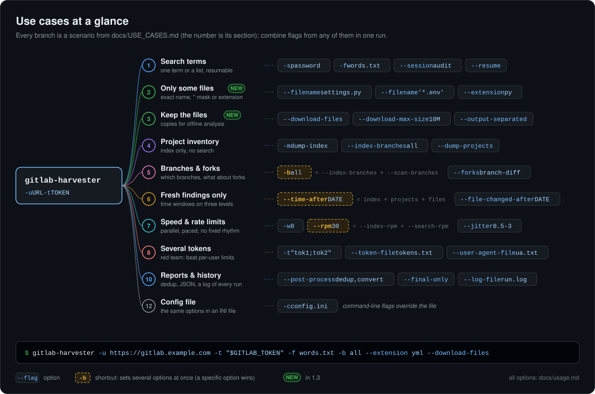

<div align="center">

# GitlabHarvester

[](https://github.com/Cur1iosity/GitlabHarvester/actions/workflows/tests.yml)
[](https://pypi.org/project/gitlab-harvester/)
[](https://pypi.org/project/gitlab-harvester/)
[](https://github.com/Cur1iosity/GitlabHarvester/blob/main/LICENSE)
[](https://pepy.tech/projects/gitlab-harvester)
[](https://github.com/Cur1iosity/GitlabHarvester/commits/main/)

</div>

**GitlabHarvester** is a lightweight tool built to install in a minute and show impact fast.
It searches every repository of a GitLab instance for keywords and secrets through the API,
without cloning, including GitLab CE, which has no instance-wide code search.

- **Red team engagements.** One token, the whole instance: credentials, internal hosts
  and pivots hiding in the code. Loud and fast or low and slow, your call: rate limits,
  jitter and User-Agent rotation keep the noise and the signature under control. Captured
  several accounts' tokens? Hand them all to one run and beat a per-user rate limit.
- **Penetration tests.** Instance-wide discovery of credentials, tokens and keys as part
  of the assessment.
- **Blue teams and security research.** Secret hunting and hygiene audits: a quick first
  look, full baselines, regular re-scans of recent activity, deduplicated reports, and a
  history of runs in the log file.
- **Developers, analysts and architects.** Not for secrets, but for code: fast search
  across a large codebase, even on GitLab CE.

<p align="center">
  
</p>

## Install

```bash
pipx install gitlab-harvester    # or: pip install gitlab-harvester
```

Requires Python 3.10+ and a GitLab token with the `read_api` scope.

## Quick start

Search one term in the default branch of every project:

```bash
export GITLAB_TOKEN='your-token-here'
gitlab-harvester -u https://gitlab.example.com -t "$GITLAB_TOKEN" -s password
```

The first run builds a project index (`<host>_project_index.jsonl`), and later runs reuse it.
Hits are written to a JSONL session file as they are found: a link to the file and line,
and the lines around the match. Read them with `jq`:

```bash
jq -r 'select(.result) | .result.project_search_result[].branch_search_result[] | .url, .data' results/*.jsonl
```

With `--download-files` every file with hits is saved whole: read the full document, or
run a secret scanner over the files offline, e.g.
`trufflehog filesystem results/password/files --no-verification`
([details](https://github.com/Cur1iosity/GitlabHarvester/blob/main/docs/usage.md#downloading-the-files-with-hits---download-files)).

Lists of terms, specific files only, saving the files with hits, all branches and forks,
fresh findings only, resuming, parallel requests and rate limits, deduplicated reports,
config files:
**[docs/USE_CASES.md](https://github.com/Cur1iosity/GitlabHarvester/blob/main/docs/USE_CASES.md)**.

<p align="center">
  <a href="https://github.com/Cur1iosity/GitlabHarvester/blob/main/docs/USE_CASES.md">
    
  </a>
</p>

## Common options

| Option | Purpose |
|---|---|
| `-b, --branches default\|all\|N` | branches to index and search |
| `--forks include\|skip\|branch-diff\|all-branches` | how forks are handled |
| `--time-after DATE`, `--time-before DATE` | limit the index, its projects and the files with hits to a time window |
| `--started-from 2024-06-01` | search only indexed projects with activity since the date |
| `--project-filter k8s,infra/*` | search only the indexed projects whose path matches (substring or mask) |
| `--filename '*.env'`, `--extension py` | search only files with this name (exact, or a mask with `*`) or extension; without a term, collect every such file |
| `--download-files`, `--download-max-size 10M` | save every file with hits to `<term>/files/` for offline analysis |
| `-t "tok1;tok2"`, `--token-file FILE` | several tokens run in parallel, each with its own workers and rate-limit budget |
| `-w, --workers N` | parallel API requests per token, for instances without rate limits |
| `--rpm N`, `--index-rpm N`, `--search-rpm N` | requests per minute per worker: all, non-search, search |
| `-m find-limits`, `--auto-limits` | *experimental*: measure the API rate limits and get `--workers`/`--*-rpm` for them; during a search, propose lower limits after HTTP 429 |
| `--jitter 0.01-0.05` | random delay before every request (seconds, or `10ms-50ms`) |
| `-A STRING`, `--user-agent-file FILE` | fixed User-Agent, or a random one from the file for every request |
| `-m dump-index`, `--dump-projects` | build or rebuild the project index |
| `--session NAME`, `--resume` | name a session and continue it later |
| `--post-process dedup,convert`, `--final-only` | deduplicate and convert the session right after the search |
| `--to-zip` | pack the run's results (session, term files, downloaded files) into `<session>.zip` |
| `-c, --config FILE` | read options from an INI file ([config.example.ini](https://github.com/Cur1iosity/GitlabHarvester/blob/main/config.example.ini)) |

See [docs/usage.md](https://github.com/Cur1iosity/GitlabHarvester/blob/main/docs/usage.md) for every option, branch and fork strategies, and the output formats,
and [docs/USE_CASES.md](https://github.com/Cur1iosity/GitlabHarvester/blob/main/docs/USE_CASES.md) for typical scenarios.

## Not a secret scanner

GitlabHarvester is **not** an alternative to [TruffleHog](https://github.com/trufflesecurity/trufflehog)
or [Gitleaks](https://github.com/gitleaks/gitleaks). It doesn't detect secrets by their
patterns or entropy, and it doesn't verify them. It is a targeted search for words across
a GitLab instance: you choose what to look for (`password`, an internal host name, a
project codename), and it finds where that word is, in every project and branch, through
GitLab's own search API.

That is where it came from: an engagement on a real corporate GitLab of about 30,000
projects, with no code search across the instance. Cloning everything wasn't an option,
and the question was "where does this word appear?".

It works well together with secret scanners:

- **Find the files worth scanning.** On a huge instance, narrow the search down to the
  projects and files of interest first, then point a scanner at those instead of at
  everything.
- **Scan what was found.** `--download-files` saves every file with hits to the disk,
  and a scanner reads them offline:

  ```bash
  gitlab-harvester -u https://gitlab.example.com -t "$GITLAB_TOKEN" -s password --download-files
  trufflehog filesystem results/password/files --no-verification
  gitleaks dir results/password/files
  ```

  Without a term, `--filename '*.env' --download-files` collects every `.env` file of the
  instance for them. `--no-verification` keeps TruffleHog from sending the secrets it
  finds to their providers to check them.

## Development

```bash
git clone https://github.com/Cur1iosity/GitlabHarvester.git && cd GitlabHarvester
pip install -r requirements-dev.txt -e .
pytest
```

The tests and local runs use a bundled Fake GitLab API, so they need no real instance:

```bash
python -m fakegitlab
gitlab-harvester -u http://127.0.0.1:8080 -t dev-token -s password -b all
```

Details: [docs/testing.md](https://github.com/Cur1iosity/GitlabHarvester/blob/main/docs/testing.md), [docs/architecture.md](https://github.com/Cur1iosity/GitlabHarvester/blob/main/docs/architecture.md).
Debian/Kali packaging readiness: [docs/packaging.md](https://github.com/Cur1iosity/GitlabHarvester/blob/main/docs/packaging.md).

## License

MIT. Use it only on GitLab instances you are authorized to work with: your own, your
organization's, or those within the scope of an agreed engagement.
